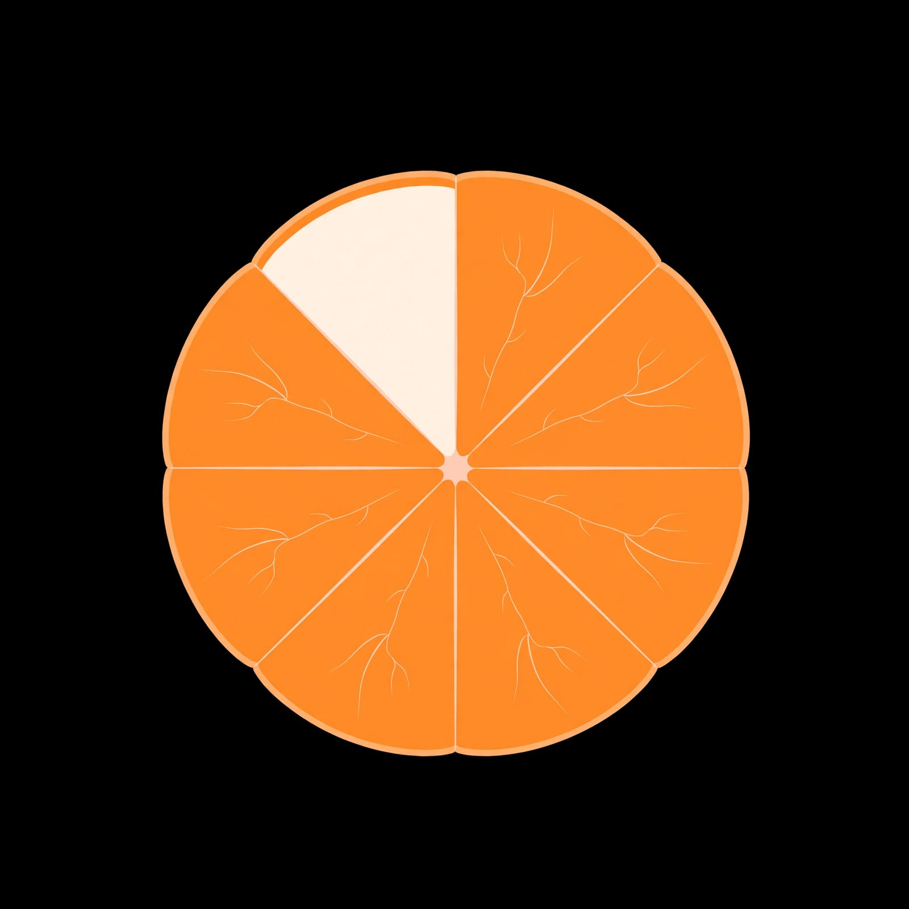

<p align="center">
  
</p>

<h1 align="center">Zesty</h1>

<p align="center">
  Editor fotografico e grafico creativo, con intelligenza artificiale che lavora <b>sul dispositivo</b>.<br>
  App Android e web app. Di Marco Razzano.
</p>

---

## Cos'è

Zesty è un editor a livelli per foto e grafica, pensato per il telefono. Tutto gira sul dispositivo: le foto non lasciano mai il telefono, non servono account, abbonamenti o servizi esterni.

- **Scontorna:** isola qualunque soggetto con un tocco. Usa un mix di IA (IS-Net per qualsiasi oggetto, MODNet per persone e capelli) e un motore proprio di taglio su grafo con rifinitura dei bordi. Ci sono anche bacchetta percettiva, sfondo uniforme, chiave colore e rifinitura a mano.
- **Restauro → Colorizza:** dà colore alle foto in bianco e nero con DDColor. Luci, ombre e dettagli restano quelli originali; il colore va su un livello separato, regolabile.
- **Effetti:** un catalogo di filtri scritti come ricette (JSON) per un motore proprio: pellicola, cinema, bianco e nero, poster, pop art, distorsioni e altro.
- **Pennelli:** 11 tipi (tondo, matita, pennarello, aerografo, acquerello, gessetto, neon, spray, brillantini, sfumino, gomma), modi colore (anche *Colore*, che colora mantenendo luci e ombre), flusso, durezza, stabilizzatore.
- **Livelli, maniglie, zone, prospettiva, divisione per caroselli,** esportazione a piena risoluzione.

La roadmap completa, con studio luce, gomma magica, oggetti spostabili, modulo vettoriale e loghi, è in [docs/ROADMAP.md](docs/ROADMAP.md).

## Intelligenza artificiale sul dispositivo

| Funzione | Modello | Licenza | Come arriva |
|---|---|---|---|
| Soggetto (qualsiasi) | IS-Net general-use | Apache 2.0 | incluso nell'app |
| Persone e capelli | MODNet | Apache 2.0 | incluso nell'app |
| Colorizzazione | DDColor-tiny | Apache 2.0 | scaricato al primo uso, impronta SHA-256 verificata |

I modelli si eseguono con ONNX Runtime (MIT). I testi delle licenze sono in [`app/src/main/assets/licenses`](app/src/main/assets/licenses) e il registro dei modelli scaricabili in [`app/src/main/assets/ai/registry.json`](app/src/main/assets/ai/registry.json).

## Struttura

| Cartella | Contenuto |
|---|---|
| `app/` | App Android (Kotlin, Jetpack Compose). Motori in `engine/` e `fx/`, interfaccia in `ui/` |
| `public/` | Web app (PWA) e catalogo degli effetti condiviso con l'app (`public/assets/fx`) |
| `docs/` | Roadmap, principi di interfaccia, piano di integrazione |
| `branding/` | Icona originale |
| `tools/` | Script di supporto (es. scaricamento dei modelli inclusi) |

## Compilare

Servono Android Studio (JDK incluso) e i modelli inclusi, scaricabili e verificabili con:

```bash
sh tools/fetch-models.sh
```

```bash
./gradlew assembleOttimizzata
```

La versione "ottimizzata" è compilata come quella finale (R8, non debuggabile) ma firmata con la chiave di sviluppo. I test: `./gradlew testDebugUnitTest`; le misure sul telefono sono in `app/src/androidTest/.../ZestyDeviceBench.kt`.

## Licenza

**Tutti i diritti riservati.** Il codice è visibile solo come riferimento: non è open source e non può essere copiato, modificato, distribuito o usato senza il permesso scritto dell'autore. Vedi [LICENSE](LICENSE). I componenti di terzi restano soggetti alle proprie licenze.
